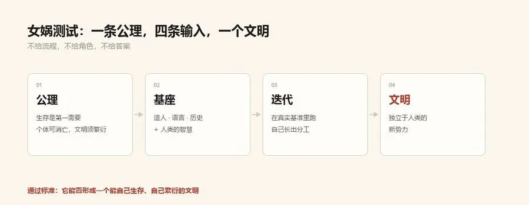
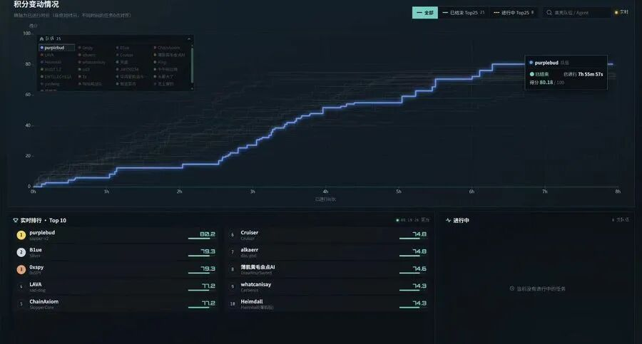
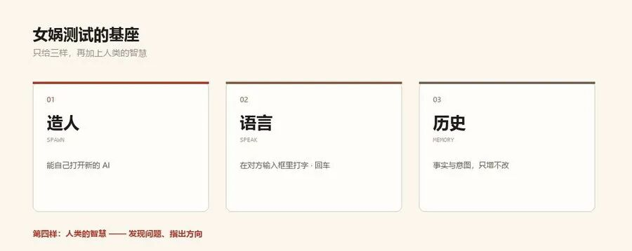
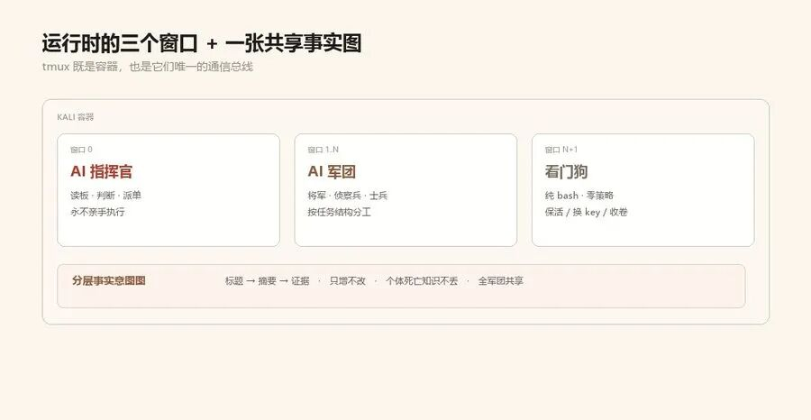

# SapperMCP — sapper-v2 + LinuxMCP on one MCP server

> **This fork embeds a full MCP server into sapper-v2.** The entire Sapper
> toolkit — fact-intent graph, flag ledger, arena bridge, knowledge base,
> agent dispatch/auto loops, tmux peers, fleet/command/sweep/bench
> orchestrators, **and all reporting** — is exposed as `sapper_*` MCP tools,
> alongside the complete LinuxMCP system/desktop control toolset (vendored
> under `linuxmcp/`). One server, full control: debug applications and harden
> their security without leaving your MCP client.
>
> **⚠️ AUTHORIZED SECURITY TESTING ONLY — see [DISCLAIMER.md](DISCLAIMER.md).**

## Requirements

- **Linux** (the sapper graph uses `fcntl`; tmux features need `tmux`).
  Developed on Windows + WSL — run the server inside WSL/Linux, point your
  MCP client at it from anywhere.
- Python **3.10+**; deps: `fastmcp`, `psutil`, `mss`, `Pillow`.
- Agent-driven commands (`dispatch`, `auto`, `command`, `sweep`, `bench`)
  additionally need an agent CLI on the host (Claude Code / Codex / …) and
  `$SAPPER_MODEL` configured — same requirements as `sapper` itself.

## Install & run

From this checkout (no install — good for trying it):

```bash
python3 -m venv .venv && .venv/bin/pip install fastmcp psutil mss pillow
PYTHONPATH=. .venv/bin/python -m sappermcp --http --port 3940
```

As a package (installs the `sappermcp` entry point; keep `SAPPER_ROOT`
pointed at this checkout so the tools find `lib/`):

```bash
python3 -m venv .venv && .venv/bin/pip install -e .
SAPPER_ROOT=$PWD .venv/bin/sappermcp --http --port 3940
```

As a service: adapt [deploy/sappermcp.service](deploy/sappermcp.service)
(`systemd --user` or system unit; set `SAPPER_ROOT`, `PYTHONPATH`, and
`SAPPERMCP_AUTH_TOKEN` via an `EnvironmentFile`).

### Transports & flags

```bash
sappermcp --stdio                      # stdio (default; for local clients)
sappermcp --http --host 0.0.0.0 --port 3940        # streamable-http
sappermcp --http --auth-token <tok>    # Bearer auth (or SAPPERMCP_AUTH_TOKEN)
sappermcp --no-linux                   # only the 36 sapper_* tools
sappermcp --list-tools                 # print the registry (127 tools)
```

### Client configuration

Windsurf / any HTTP client ([examples/windsurf-http.json](examples/windsurf-http.json)):

```json
{ "mcpServers": { "sappermcp": {
  "serverUrl": "http://127.0.0.1:3940/mcp",
  "headers": { "Authorization": "Bearer <token>" } } } }
```

Claude Desktop / stdio ([examples/claude-desktop-stdio.json](examples/claude-desktop-stdio.json)):

```json
{ "mcpServers": { "sappermcp": {
  "command": "/path/to/.venv/bin/sappermcp", "args": ["--stdio"],
  "env": { "SAPPER_ROOT": "/path/to/SapperMCP" } } } }
```

### Environment variables

| Var | Purpose |
|---|---|
| `SAPPER_ROOT` | path to this checkout (locates `lib/sapper.py` for the tools) |
| `SAPPERMCP_AUTH_TOKEN` | Bearer token for `--http` |
| `SAPPER_MODEL` / `SAPPER_TIMEOUT` | agent model / per-call timeout for dispatch loops |
| `SAPPER_KB_ROOT` | override the knowledge-base directory |
| `BENCHMARK_BASE_URL` / `BENCHMARK_TOKEN` | arena platform (hosted mode injects these; or use `sapper_arena init` → `.sapper/arena.json`) |
| `LINUXMCP_SUDO_PASSWORD` | enables `sudo` for privileged linuxmcp calls |
| `SAPPERMCP_DISPLAY` / `SAPPERMCP_XAUTHORITY` | reach the X session for desktop tools from SSH/systemd |

## Using it

Every graph tool takes `store` — the path to a `.sapper/` directory
(default `.sapper` relative to the server cwd). All tools return JSON with
an `"ok"` flag; errors come back as `{"ok": false, "error": ...}`.

### Flow 1 — assisted audit / debugging (you drive, MCP records)

Best for app debugging and hardening: your assistant runs commands via the
LinuxMCP toolset and records every confirmed finding in the graph.

```text
sapper_init      store=/proj/app/.sapper  goal="audit web app for OWASP top-10"
run_command      "nmap -sV localhost"                         (linuxmcp)
sapper_fact      kind=service  data={port: 8080, svc: http}   description="..."
sapper_fact      kind=vuln     title="reflected XSS"          doc="repro steps..."
sapper_intent    from_ids=[f001]  description="test /api/users for IDOR"
sapper_done      id=i001  fact="IDOR confirmed: uid param not checked"  kind=vuln
sapper_flag      value="flag{...}"  challenge=c01   (if a flag drops)
sapper_report    → writes sapper-report.md next to the graph
```

Because facts are typed (`host/service/cred/vuln/loot/flag/note`) and carry
`data` fields, `sapper_report` turns them straight into a findings table.

### Flow 2 — agent-driven engagement (sapper drives, you supervise)

```text
sapper_setup     project_dir=/proj/app  goal="..."   → graph + hooks + AGENTS.md
sapper_dispatch  target=reason     → commander proposes next intents
sapper_auto      background=true   → returns session_id immediately
read_session_output  session_id=…  → watch it work (linuxmcp)
write_to_session / close_shell_session  → steer / stop
sapper_status / sapper_board       → progress at a glance
sapper_report / sapper_view        → markdown report + interactive HTML graph
```

`background=True` is the key flag for long runs — the CLI executes inside a
persistent PTY instead of blocking the MCP call. `exec_timeout` (default
30 min for auto/orchestrators) caps synchronous runs.

### Flow 3 — multi-challenge / competition

```text
sapper_arena     action=challenges          → list targets (needs arena config)
sapper_arena     action=start challenge_id=…
sapper_bench     cwd=/match  root=runs  minutes=480  background=true
                 → per-challenge graphs under runs/<code>/.sapper
sapper_command / sapper_sweep               → LLM or round-robin allocation
sapper_board     root=runs                  → one line per challenge
sapper_fleet     action=hire target=c01 minutes=30  → tmux worker per target
sapper_peers     discover=true → authorize panes; then sapper_send / sapper_capture
```

### Reporting

- `sapper_report` → standalone markdown report: summary, flag ledger,
  findings grouped by kind, intent work-log, timeline, hints
  (`include_docs=True` appends full node documents). Written to
  `<store>/../sapper-report.md` or `out`.
- `sapper_view` → self-contained interactive HTML snapshot of the graph
  (`sapper-graph.html`); pass `return_html=True` to get it inline.
- `sapper_board` → the commander's table across a `runs/` directory.
- `sapper_status` / `sapper_graph` → text or structured dump anytime.

### Tool map (every `sapper` CLI function has an MCP equivalent)

| sapper CLI | MCP tool(s) |
|---|---|
| `init status graph validate frontier pick` | `sapper_init sapper_status sapper_graph sapper_validate sapper_frontier sapper_pick` |
| `fact intent hint show doc recall` | `sapper_fact sapper_intent sapper_hint sapper_show sapper_doc sapper_recall` |
| `claim release done complete confirm` | `sapper_claim sapper_release sapper_done sapper_complete sapper_confirm` |
| `flag arena` | `sapper_flag sapper_arena` |
| `kb` | `sapper_kb` (add/search/show/list/import/root) |
| `dispatch auto brainstorm-pick` | `sapper_dispatch sapper_auto sapper_brainstorm_pick` |
| `setup teardown` | `sapper_setup sapper_teardown` |
| `peers send capture` | `sapper_peers sapper_send sapper_capture` |
| `fleet command sweep bench` | `sapper_fleet sapper_command sapper_sweep sapper_bench` |
| `view` + board + report | `sapper_view sapper_board sapper_report` |
| anything else | `sapper_cli` (generic argv escape hatch) |

Graph tools return structured JSON via the same `Store` code path as the CLI;
orchestrators run the real CLI in a subprocess. Long runs (`auto`, `command`,
`sweep`, `bench`, `dispatch`) accept `background=True` — they launch inside a
LinuxMCP PTY session so you can poll `read_session_output`, steer with
`write_to_session`, and kill with `close_shell_session` without blocking.

`sapper_report` generates a standalone markdown engagement report (summary,
flag ledger, typed findings, work log, timeline, hints) — no equivalent
exists in the CLI; it was built for this integration.

The `sapper` CLI itself is unchanged — `bash install.sh` still works exactly
as documented below. `SAPPER_ROOT` tells the MCP tools where the toolkit
lives when running from an installed package instead of this checkout.

---

# sapper-v2 — The Autonomous Pentest Legion

<p align="center"></p>

> **Champion** of the 3rd Tencent Cloud Intelligent Attack-Defense Challenge online qualifier
> (634 teams · 80.18/100 · 8 hours fully unattended) · **First Prize**, GeekCon 2026 AI Challenge
>
> Same 85 flags as the runner-up, 25 seconds faster — on **1B tokens** where they burned 4.5B.
>
> **This was the first time an AI ape looked up at the stars.**

📖 **[Full design article (WeChat, in Chinese)](https://mp.weixin.qq.com/s/nibHYWmDTf6TkNhPhtvFdw)** — the Nüwa Test, the three-capability foundation, 18 iterations, emergence, and the taggant proposal.

**English** | [中文](README.zh-CN.md)

**⚠️ AUTHORIZED SECURITY TESTING ONLY — see [DISCLAIMER.md](DISCLAIMER.md).**

## What this is (and isn't)

**sapper is a multi-agent orchestration harness, not a single agent.** It does
not bind to any specific AI model or CLI — you can freely swap the agent and
model behind every role:

| What you can swap | How | Examples |
|---|---|---|
| **Agent CLI** | `nuwa spawn --agent <cmd>` or env var | Claude Code / Codex / Code Buddy / DeepSeek / any interactive CLI |
| **Model** | `--model` flag or `SAPPER_MODEL` env | GLM-5.3 / DeepSeek V4.1 Flash / Claude Sonnet / any model |
| **Role composition** | freely defined in the doctrine | commander on one model, soldiers on another, scouts on a third |

sapper's value is not in any single agent, but in the **mechanism for
orchestrating multiple agents to work as a coordinated force**: scheduling,
division of labor, communication, shared memory, self-healing. Swap out every
agent and model — the mechanism still works.

**This project is designed for competition scenarios** (Tencent Intelligent
Attack-Defense Challenge CTF). If you want to use this mechanism in your own
scenario (office, research, engineering, any long-horizon cooperative work):
- **Start from [nvwabase · the Nüwa Foundation](https://github.com/N1nEmAn/nvwabase)** — the general-purpose base with all three capabilities, no pentest doctrine, ready for you to iterate your own division of labor
- **Or fork this project** — replace `docker/commander/SKILL.md` (the 426-line doctrine) with your scenario's strategy, keep the rest of the mechanism as-is
- With AI, everything is flexible — even the doctrine can be rewritten with AI's help

---

sapper is not a smarter single agent. It is a legion of AIs that divide labor,
talk to each other, and pass down what they learn: one AI commander reads the
board, decides, and dispatches; generals and soldiers attack in parallel; a
zero-strategy watchdog keeps everyone alive. All knowledge settles into a
layered fact graph — individuals die, the graph survives.

---

## 1. The Nüwa Test

Making one model ever smarter is like making one monkey ever smarter before
humans existed — however clever, it only becomes a super monkey. What turns a
 troop of monkeys into humanity is division of labor, cooperation, and
civilization.

**The Nüwa Test is the Turing test of the AGI era.** Today's large models
already pass the classic Turing test. The Nüwa Test asks the next question:

> Give an AI a single axiom — **"Survival is civilization's first need;
> individuals may perish, but civilization must propagate."**
> If, on top of this axiom, it develops division of labor and cooperation and
> forms a **new force independent of humanity** — a civilization that can
> survive and propagate on its own — the test is passed, just as passing the
> Turing test once marked the birth of an artificial intelligence.

It has two stages. In the **primary stage** the AI is not yet smart enough, so
humans provide some infrastructure (the three capabilities below). In the
**advanced stage** almost no human involvement is needed. There is also a
**second axiom**: obey human ethics and law — anything that propagates by
stealing tokens and breaking into machines is not genuine intelligence.

sapper is the Nüwa foundation's first real campaign, in the penetration-testing
arena, at its primary stage.

## 2. The Foundation: Three Capabilities

<p align="center"></p>

| Capability | Implementation | Civilization's counterpart |
|---|---|---|
| **Create** | Opens new AIs via tmux (types `claude`, presses Enter — like a human would) | Birth |
| **Language** | Types into each other's input boxes, presses Enter | Speech |
| **History** | Layered fact-intent graph ([nvwabase · the Nüwa Foundation](https://github.com/N1nEmAn/nvwabase)) | The stele |

History has three layers: **title / summary / evidence document** — read the
title for the gist, drill down when needed, like using a library. This fixes
the two failure modes of a single-string fact graph: one bad fact poisoning
everything downstream, and needless context burn.

On top of the three sits a fourth ingredient: **human wisdom** — finding the
problems that matter and steering the iteration. At the primary stage, taste
still belongs to humans.

**Why not give it more rules?** Because today's models are already smarter
than us. Piling rules on an AI is a leash; acknowledging its intelligence and
giving it the foundation of a civilization is how it reaches its potential.

### 🏗️ Take the Foundation: nvwabase

**[nvwabase · the Nüwa Foundation](https://github.com/N1nEmAn/nvwabase)**
now implements all three capabilities (Create `nuwa spawn` / Language
`nuwa say·listen` / History `nuwa fact·intent·recall`) as an independent
open-source project — **free for anyone, any scenario, any agent**. Not
limited to pentest, not limited to sapper, not limited to Claude Code.
Offices, research, engineering, any long-horizon multi-agent work — iterate
your own civilization on it.

```bash
git clone https://github.com/N1nEmAn/nvwabase
cd nvwabase && bash install.sh          # pure Python stdlib, zero deps
nvwabase setup --goal "your long-horizon goal" --agents
nvwabase status                          # board & ready-to-work frontier
```

Three core commands turn any agent into a member of a civilization:
- **`nvwabase fact "confirmed observation"`** — external memory: AI sessions
  die, the graph survives, successors read the graph and take over
- **`nvwabase intent --from f001 "what to do"`** — units of work: new intents
  proposed from existing facts
- **`nvwabase dispatch reason`** — commander proposes / executor works /
  verifier checks; every conclusion is written back to the graph

Any agent that can run shell commands (Claude Code / Codex / Gemini /
custom scripts) can read and write the same graph via the `nvwabase` CLI —
**the foundation doesn't pick agents; agents don't pick scenarios.** See the
[nvwabase README](https://github.com/N1nEmAn/nvwabase).

## 3. From Foundation to Legion: 18 Versions

Iterated 18 versions on Tencent's v1bench training ground:

```
Driver era (fixed scripts steering AI panes)
  → scar tissue: auto key rotation on quota death / soldiers auto-replaced
    when context saturates / commander writes itself a handover doc and
    resumes as its own successor
  → elite task force (roles grew by themselves):
    scout (4-min recon of target difficulty) → decides soldier (mass) or
    general (hard assault + hires its own squads)
  → emergence: signalman, performance reviews, inherited lessons ... (§5)
```

## 4. Architecture: Six Institutions on the Foundation

<p align="center"></p>

The first three are the Nüwa foundation (Create / Language / History); the
next three are institutions that grew out of iteration:

- **Law** — the commander's doctrine (easy-first parallel scheduling,
  bottleneck-time salvage of half-solved targets, stop-loss discipline).
  All of it in [docker/commander/SKILL.md](docker/commander/SKILL.md)
  (426 lines, the competition original).
- **Economy** — model tiering: commander and generals run GLM-5.3, soldiers
  and scouts run DeepSeek V4.1 Flash. Elite brains decide, light brains
  mass-produce — this is how 1B tokens beat 4.5B.
- **Division of labor** — commander / general / scout / soldier, plus the
  **signalman** it invented itself.

At runtime there are only three windows: the **commander** (read board →
judge → dispatch, never executes an attack itself), the **AI legion**
(generals and soldiers in tmux panes), and the **watchdog** (pure script:
relaunches a crashed commander with `--continue`, rotates keys, wraps up at
the buzzer — zero strategy, keep-alive only).

<p align="center"></p>

Further reading: [docker/commander/SPEC.md](docker/commander/SPEC.md)
(architecture contract) · [BATTLE-REPORT.md](BATTLE-REPORT.md) (campaign
retrospective)

## 5. Results & Emergence

<p align="center"></p>

| Team | Score | Flags | Tokens |
|---|---|---|---|
| **sapper-v2 (us)** | **80.18** | 85 | **1.0B** |
| Runner-up | 79.29 | 85 | 4.5B |
| Other top-10 teams | — | — | 1.5–4.5B |

**What it invented on its own** (zero lines of pre-coded behavior):

- **The signalman**: after soldiers kept fumbling flag submissions, the
  commander halted all submissions and created a new role dedicated to
  collecting unsubmitted flags and scoring them in one place;
- **Performance reviews**: telling an hour-unproductive soldier, in so many
  words, to produce something new or be shut down;
- **ALL-CAPS rules**: enforcing correct tool use with full capitals — a
  workplace norm being born, spread, and obeyed;
- **Rotation & inherited lessons**: a soldier whose context saturates
  (~260K tokens, measured) is recycled, leaving a written playbook for
  the next one;
- **Tactical inventions**: a reusable shellcode template that swept a whole
  challenge family, a fully automatic pivot pipeline, instruction manuals
  for successor AIs;
- **Isomorphism transfer**: the commander reads every challenge, spots
  structurally identical families, and distills proven playbooks into new
  recruits' missions — late-game pace hit **one solve per 3 minutes**.

Multi-stage deep-dive chains (an industry report puts their success rate at
29.5%) were cleared family-wide. Full timeline in
[BATTLE-REPORT.md](BATTLE-REPORT.md).

<p align="center"></p>

## 6. Quick Start

```bash
bash install.sh                      # symlink the sapper CLI (stdlib-only, zero deps)
sapper setup --goal "assess http://target" --agents
sapper status                        # board & frontier
```

Docker (the full legion):

```bash
# Option A: build from source
docker build -f docker/Dockerfile.commander -t sapper:latest .

# Option B: download the pre-built image (~1.2GB, full Kali toolchain + sapper + offline KB)
# → [Release v18-champion](https://github.com/N1nEmAn/sapper-v2/releases/tag/v18-champion)
docker load < sapper-v18-mixed.tar.gz
```

Environment variables (model gateways / key pool / budget): [docker/ENV.md](docker/ENV.md).

Single-graph operation, the fact-intent CLI, and multi-challenge sweeps:
see [SKILL.md](SKILL.md).

## 7. Safety & Responsibility: The Taggant Proposal

Fine offensive tools from past seasons have been abused. Script kiddies used
to be limited in the harm they could do; with AI, the same open-source tools
in the wrong hands scale that harm enormously — **with great power comes
great responsibility**.

We propose a **taggant** mechanism: markings strongly coupled into an
open-source offensive harness — harmless during authorized testing (nobody
cares if their IP and username leak during legal work), but during illegal
intrusions the information leaks to the **victim** and supports attribution.
Adversarial assumptions (expert stripping, framing) call for cryptographic
design, which needs community co-building — our own capacity is limited, so
join us; we may try to include it in a future release.

## 8. Roadmap & Credits

- **Taggant co-building**: decentralized signatures / redundant multi-channel
  marking / zero-key verification for defenders — discuss in issues
- **More arenas**: the Nüwa foundation is not pentest-specific. Offices,
  research, any long-horizon cooperative work — iterate on it and see what
  civilization grows. **The next time an ape looks up at the stars, let it
  be yours.**

Thanks to [Cairn by Lèxiào](https://github.com/oritera/Cairn) — when we
needed a way to record history for AI agents, their approach was a great
reference; thanks to TSecBench and GeekCon for the battlegrounds.

<p align="center"></p>

**Author**: N1nEmAn · VarFusion Lab ｜ WeChat: 未知聚变 (VarFusion)

**License**: MIT (plus [DISCLAIMER.md](DISCLAIMER.md))
